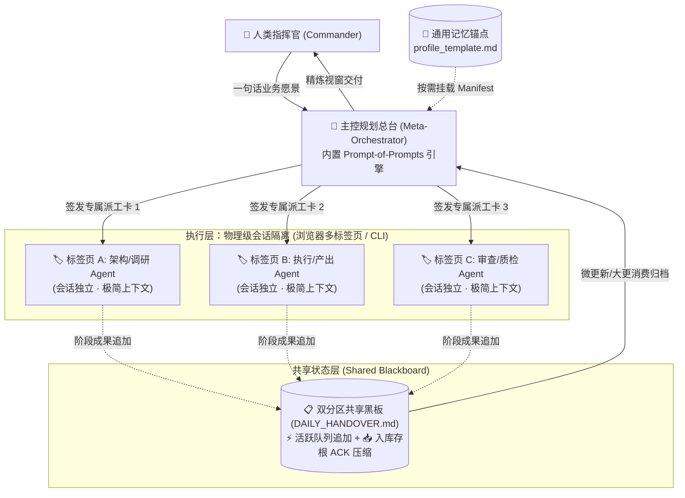

# MetaAgentFlow ⚡

> **Chat-Native 普惠型多智能体协同协议 (Chat-Native Multi-Agent Orchestration Protocol)**  
> 告别复杂 Python 框架与高昂 API 调用。基于 **「元提示词生成 (Prompt-of-Prompts) + 物理会话隔离 (Physical Context Isolation) + 双分区共享黑板 (Queue & ACK Blackboard)」**，让每个人都能在普通对话框中零代码编排属于自己的专业级多智能体舰队。

[](CHANGELOG.md)
[](LICENSE)
[]()
[]()
[](CONTRIBUTING.md)
[](README_EN.md)

---

## 💡 为什么需要 MetaAgentFlow？

当前以 LangGraph, CrewAI, AutoGen 为代表的主流多智能体系统存在两个天然壁垒：
1. **重度代码束缚与高昂成本**：依赖 Python 编程、复杂的环境调试与持续消耗的商用 API Token，将 95% 以上文科、经管以及没有编程背景的高校师生与职场人拒之门外；
2. **长程会话“越聊越笨”**：单会话交互超过 20 轮后，由于自注意力机制稀释（Context Dilution），模型响应迟钝、频繁遗忘规则、出现严重事实幻觉；
3. **“祥林嫂式”重复输入**：每次新开对话都要重新交代个人背景、审美风格、设备工具链与业务禁忌。

**MetaAgentFlow 提供了一套颠覆性的 Chat-Native 解法：**
- 🌟 **零代码即插即用**：只需粘贴一段系统 Prompt，网页端免费大模型（豆包、DeepSeek、Kimi、Claude 等）秒变调度总台；
- 🛡️ **物理级抗降智 (Physical Context Anti-Bloating)**：借助多标签页沙盒隔离执行，任务完成后仅提取核心成果写入黑板，单任务即用即抛，上下文永远处于算力峰值；
- 📋 **双分区黑板总线 (Queue & ACK Blackboard)**：通过“待处理活跃区追加 + 已结算入库存根压缩”，彻底解决日内二次更新时的 Token 重复爆炸问题；
- 🎯 **元提示词引擎 (Prompt-of-Prompts)**：主控总台根据人类的一句话目标，自适应生成 2~3 个精准派工卡（包含严格的 Manifest 输入清单与红旗报警熔断机制）；
- 📌 **个人记忆锚点 (Personal Anchor)**：一次填写事实底座，按需订阅，彻底告别重复背景交代。

---

## 🏛️ 核心架构与原理解析



---

## 🚀 3 分钟极速上手

### 步骤 1：复制并配置【个人事实档案】(Personal Anchor)
复制 [`templates/profile_template.md`](./templates/profile_template.md)，填写你的基础信息、审美风格与工具禁忌。只需填写一次，后续所有 Agent 均以此为对齐基线。

### 步骤 2：启动你的【主控调度总台】(Meta-Orchestrator)
新建一个空白对话框（推荐使用推理能力强的大模型，如 DeepSeek-R1 / Claude 3.5 Sonnet / 豆包深度思考版），直接复制粘贴 [`prompts/orchestrator_system_prompt.md`](./prompts/orchestrator_system_prompt.md) 发送。

总台将自动输出三模选择：
- **[A] 萌新保姆模式**：单步单选，手把手带你完成多标签页操作；
- **[B] 熟手高效模式**：秒出 WBS 结构与派工卡；
- **[C] 极客工坊模式**：指导你定制属于团队的专属业务流水线。

### 步骤 3：下达目标并开启并行派工
向主控发送一句话目标：
> *“我有个人档案 [profile_template.md]，现在想要做一个 [你的目标，如：顶刊文献综述矩阵 / AIGC 60秒短片剧本]。请帮我拆解 3 节点流水线并出具派工卡。”*

主控总台将立即生成包含以下规范的独立卡片：
1. 📋 **专属派工卡**：新建标签页粘贴即刻开工；
2. 🚩 **阻断报警卡**：遇到关键数据缺失时自动熔断停止，杜绝幻觉脑补；
3. 📦 **黑板存档卡**：听到“存档”直接追加写入共享黑板，干净收尾。

---

## 📂 仓库全景目录

```text
MetaAgentFlow/
├── .gitignore                      # 严格脱敏与零隐私进库规则
├── LICENSE                         # MIT 开源许可证
├── CHANGELOG.md                    # 版本演进日志 (v1.1.0)
├── README.md                       # 中文核心说明文档
├── README_EN.md                    # 英文说明文档
├── SKILL.md                        # MetaAgentFlow 协议完整规范标准
├── templates/                      # 基础模板库 (可直接复用)
│   ├── profile_template.md         # 个人事实与记忆锚点模板
│   ├── handover_template.md        # 双分区共享黑板模板 (Queue & ACK)
│   ├── workflow_spec_template.md   # 自定义多智能体工作流设计规范
│   └── red_flag_template.md        # 阻断报警与防脑补熔断卡模板
├── prompts/                        # 开箱即用提示词集
│   ├── orchestrator_system_prompt.md  # 主控规划总台系统提示词 (三模自适应)
│   ├── domain_agent_cold_start.md     # 执行端子 Agent 通用冷启动协议
│   └── domain_agent_handover.md       # 执行端子 Agent 存档与黑板写入规范
├── docs/                           # 深度理论与指导手册
│   ├── ARCHITECTURE.md             # 架构深度剖析 (黑板模型/认知负荷/以睡为界)
│   ├── PROMPT_ENGINEERING_GUIDE.md # Prompt 逆向设计与 CRIS 范式心法
│   ├── MULTI_TAB_PRACTICE.md       # 浏览器多标签页协作与物理隔离实战
│   └── ACADEMIC_REPORT_TEMPLATE.md # 面向高校/课题汇报的研究方案模板
└── examples/                       # 生产级端到端实战案例
    ├── 01_aigc_multimodal_pipeline/# 案例 1: AIGC 视频分镜与提示词流水线
    ├── 02_academic_empirical_research/# 案例 2: 学术实证研究与文献矩阵
    └── 03_product_dev_feature_sprint/ # 案例 3: 敏捷产品研发特性冲刺
```

---

## 🌟 核心理念与开源愿景

MetaAgentFlow 不仅仅是一组提示词，它是一套**以人为中心的人机共生（Human-in-the-Loop）新范式**。

我们坚信：
> **大模型时代的核心竞争力，本质上是管理学与系统工程能力的映射。**  
> 任务分解（WBS）、流程再造（BPR）与知识转移管理（Knowledge Transfer），不应该被昂贵的技术门槛垄断。

- 🌍 **完全免费且开源**：降低技术门槛，让每一位大学生、文科商科师生与创作者都能享受多智能体红利；
- 🤝 **欢迎参与贡献**：欢迎提交 Issue、PR、或是贡献你所在行业的专属 Workflow 模板！

---

## 📄 许可证 (License)

本项目遵循 [MIT License](LICENSE) 开源协议。
