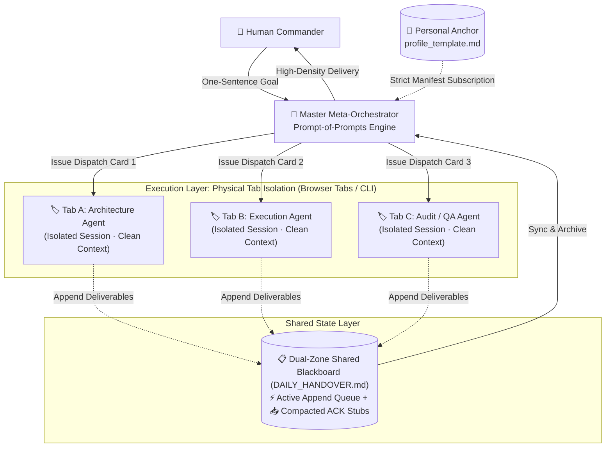

# MetaAgentFlow ⚡

> **Chat-Native Multi-Agent Orchestration Protocol**  
> Say goodbye to heavy Python frameworks and costly API wrappers. Empowered by **Prompt-of-Prompts Engine + Physical Context Isolation + Dual-Zone Queue & ACK Blackboard**, MetaAgentFlow allows anyone to orchestrate high-performing multi-agent swarms with zero code, zero API costs, and zero context degradation.

[](CHANGELOG.md)
[](LICENSE)
[]()
[]()
[](CONTRIBUTING.md)
[](README.md)

---

## 💡 Why MetaAgentFlow?

Existing multi-agent frameworks (e.g., LangGraph, CrewAI, AutoGen) face severe barriers:
1. **High Engineering Barriers & API Bills**: Demands Python programming, environment setups, and non-stop commercial API calls, locking out over 95% of non-technical researchers, students, and professionals.
2. **Context Dilution & Hallucinations**: After 20+ turns in a single chat, Transformer attention dilutes. The model becomes slow, forgets prior constraints, and hallucinates aggressively.
3. **Repetitive Context Re-explanation**: Starting a fresh chat forces users to painfully re-explain their background, preferences, toolchains, and project rules.

**MetaAgentFlow delivers a lightweight Chat-Native paradigm:**
- 🌟 **Zero-Code Plug-and-Play**: Paste a system prompt into any chat interface (DeepSeek, Claude, ChatGPT, Kimi), turning it into an orchestration hub instantly.
- 🛡️ **Physical Context Anti-Bloating**: Workflows execute across independent browser tabs/windows. Once a task completes, its deliverables are saved to the blackboard, and the tab is closed. Context always stays fresh.
- 📋 **Dual-Zone Queue & ACK Blackboard**: Solves token explosion with an append-only active queue and acknowledged 1-line compacted stubs.
- 🎯 **Prompt-of-Prompts Engine**: Master Orchestrator translates a 1-sentence goal into tailored agent dispatch cards with strict dependency manifests and circuit-breaker flags.
- 📌 **Personal Profile Anchor**: Write your background once; agents subscribe on demand.

---

## 🏛️ System Architecture



---

## 🚀 3-Minute Quick Start

### Step 1: Set Up Your Profile Anchor
Copy [`templates/profile_template.md`](./templates/profile_template.md) and fill in your background, preferred style, and tools. Do this once; agents align automatically.

### Step 2: Launch the Master Orchestrator
Open a fresh chat window (models with strong reasoning capabilities are recommended, such as DeepSeek-R1, Claude 3.5 Sonnet, or GPT-4o), and copy-paste [`prompts/orchestrator_system_prompt.md`](./prompts/orchestrator_system_prompt.md).

The orchestrator greets you with 3 adaptive modes:
- **[A] Novice Guide**: Step-by-step tutorial leading you through multi-tab workflows;
- **[B] Power Dispatch**: Instant WBS task decomposition and rapid dispatch cards;
- **[C] Geek Workshop**: Interactive design for custom domain pipelines.

### Step 3: Dispatch & Run
Send your goal:
> *"I have my profile anchor. Now I want to create [your target, e.g., empirical literature matrix / AIGC video screenplay]. Please decompose it into a 3-stage pipeline and generate dispatch cards."*

The orchestrator returns standardized cards:
1. 📋 **Dispatch Card**: Paste into a fresh tab to launch the domain agent;
2. 🚩 **Red Flag Card**: Stops execution immediately if key data is missing;
3. 📦 **Handover Card**: Appends progress directly to the shared blackboard upon saying "archive".

---

## 📂 Repository Structure

```text
MetaAgentFlow/
├── .gitignore                      # Zero-privacy leakage rules
├── LICENSE                         # MIT License
├── CHANGELOG.md                    # Changelog (v1.1.0)
├── README.md                       # Chinese Documentation
├── README_EN.md                    # English Documentation
├── SKILL.md                        # MetaAgentFlow Protocol Specification
├── templates/                      # Reusable Core Templates
│   ├── profile_template.md         # Personal profile & memory anchor
│   ├── handover_template.md        # Dual-zone shared blackboard (Queue & ACK)
│   ├── workflow_spec_template.md   # Custom multi-agent pipeline specification
│   └── red_flag_template.md        # Fail-fast red flag circuit breaker
├── prompts/                        # Ready-to-use Prompt Library
│   ├── orchestrator_system_prompt.md  # Master orchestrator prompt (3 modes)
│   ├── domain_agent_cold_start.md     # Domain agent universal cold-start
│   └── domain_agent_handover.md       # Domain agent blackboard handover
├── docs/                           # Theoretical Foundations & Guides
│   ├── ARCHITECTURE.md             # Deep architectural breakdown
│   ├── PROMPT_ENGINEERING_GUIDE.md # CRIS pattern & reverse prompt engineering
│   ├── MULTI_TAB_PRACTICE.md       # Multi-tab workflow & context hygiene
│   └── ACADEMIC_REPORT_TEMPLATE.md # Academic research / university proposal template
└── examples/                       # Production Real-World Use Cases
    ├── 01_aigc_multimodal_pipeline/# Example 1: AIGC video script & prompt pipeline
    ├── 02_academic_empirical_research/# Example 2: Empirical literature review & model
    └── 03_product_dev_feature_sprint/ # Example 3: Agile feature sprint & QA review
```

---

## 🌟 Philosophy & Vision

MetaAgentFlow is more than a prompt library; it represents a **Human-in-the-Loop collaborative paradigm**.

We believe:
> **In the age of LLMs, operational effectiveness is fundamentally a reflection of management science and systems engineering.**  
> Work breakdown structures (WBS), business process re-engineering (BPR), and knowledge transfer management should belong to everyone, not just programmers.

- 🌍 **Free & Open Source**: Democratizing multi-agent workflows for educators, students, and creators worldwide.
- 🤝 **Contributions Welcome**: We welcome Issues, PRs, and domain-specific workflow contributions!

---

## 📄 License

This project is licensed under the [MIT License](LICENSE).
