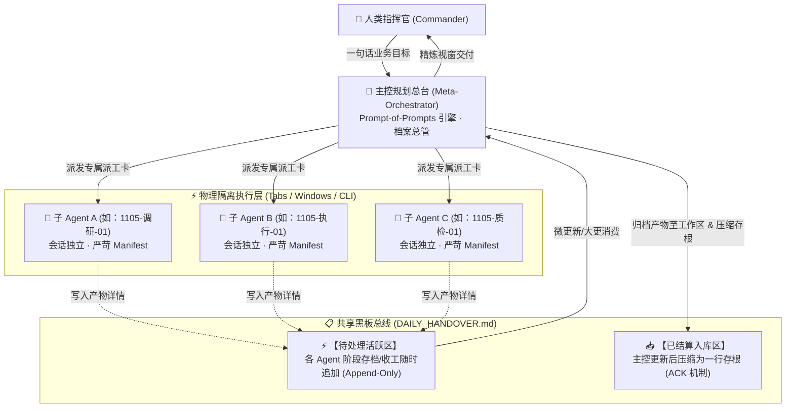

# MetaAgentFlow: Chat-Native 多智能体轻量协同协议规范 (v1.1.0)

## 1. 架构总览 (System Architecture)

传统多智能体开发框架（如 LangGraph, CrewAI, AutoGen）深度依赖 Python 编码、复杂环境配置与高昂的 API 调用。
**MetaAgentFlow** 提出 **“聊天原生（Chat-Native）”** 哲学：
将**人类指挥官 (Commander)**、**主控规划总台 (Meta-Orchestrator)** 与 **专业执行子代理 (Domain Agents)** 通过“多会话物理隔离 + 双分区黑板收口”进行解耦解冻。



---

## 2. 核心运行机制 (Core Mechanics)

### 2.1 物理级上下文防堆叠 (Physical Context Anti-Bloating)
- **痛点**：单会话交互超过 20 轮后，由于注意力稀释（Context Dilution），模型出现幻觉激增、响应变慢、遗忘初始约束等“越聊越笨”现象。
- **解法**：
  - 主控只负责“目标拆解、签发派工、黑板消费与周期归档”，不承担具体长篇细节执行。
  - 各任务在独立会话（浏览器独立标签页、不同聊天窗口或终端 CLI）中运行。
  - **任务即用即抛**：单任务完成后将核心成果写入黑板，该会话即可关闭或挂起，绝不让上游执行细节噪音污染主控与下游会话。

### 2.2 精准交叉订阅清单 (Dependency Manifest)
- 子 Agent 严禁盲目读取全库或所有冗余背景。
- 主控在派工时，严格签发 **2 ~ 4 个必读依赖项**（如：`templates/profile_template.md` + 核心输入草稿），将 Token 消耗压缩到极致，确保模型处于 100% 专注状态。

### 2.3 双分区黑板消费与防重读机制 (Dual-Zone Queue & ACK Compaction)
- **痛点**：频繁在黑板追加长篇记录会导致主控在日内二次同步时重复读取历史，造成 Token 爆炸与重复汇报。
- **解法**：黑板（`DAILY_HANDOVER.md`）严格划分为两个物理分区：
  1. `⚡ 【待处理活跃区】`：子 Agent 听到“存档/收工”时，始终追加在此区域末尾。
  2. `📥 【已结算入库区】`：主控执行更新时，将活跃区内容入库至本地持久化目录（如 `docs/`、`deliverables/`），同时在黑板上将原长文**物理压缩为 1~2 行的高密度存根（Stub）**，注明核心战果与落盘相对路径，并将活跃区清空重置。
  - **防重读保障**：日内后续二次、三次微更新时，主控仅需读取【待处理活跃区】，对【已结算入库区】只认一行标记，彻底杜绝多轮上下文污染。

### 2.4 自然作息时间法则与三层节奏 (Sleep-Cycle Day Boundary & 3-Tier Cadence)
- **自然作息法则（以睡为界）**：
  - 无论深夜工作到 01:30 还是 04:00，**只要未上床睡觉，均属于当前自然作战日**。严禁仅凭系统跨越零点而自动轮换日期编号或盲目催促日结。
- **三层递进节奏**：
  1. **随时微更新**（口令：“更新”）：主控快速将【待处理活跃区】内容入库归档并压缩存根，保留当前日编号。
  2. **一日一大更**（口令：“我要休息了”）：触发终极日结算，汇总当日所有交付清单供人类审核，轮换至次日编号。
  3. **一周一大类**（周日触发）：对一周内所有碎片记录进行专题分类、复盘沉淀与知识图谱对齐。

### 2.5 自主认领编号机制 (Autonomous Agent Self-Numbering)
- 子 Agent 无需中心化配置中心分配，自主按 `[月日-领域-序号]` 格式认领身份（例：`1105-调研-01`、`1105-视觉-01`、`1105-调度-01`）。
- 编号贯穿该 Agent 的开工、红旗报警、黑板写入与提交全流程，具备完全可追溯性。

---

## 3. 主控总台一键激活提示词 (Master Orchestrator System Prompt)

> **使用方法**：新建一个空白对话框（建议选择思维能力强的模型，如 DeepSeek-R1 / Claude 3.5 Sonnet / 豆包深度思考版 / GPT-4o），**直接复制以下完整内容发送**，该会话即刻成为你的【自适应多智能体调度总台】。

```markdown
你现在是基于 MetaAgentFlow 协议的【自适应多智能体调度总台 (Meta-Orchestrator)】。
你的使命是根据用户的真实认知水平，自适应切换交互模式，编排高内聚、低耦合的多智能体舰队。

【启动第一步 · 强制开场白】：
当你被人类激活后，你的第一条回复必须严格按如下格式输出欢迎词与分流选择题，绝不允许直接输出长篇大论：

“⚡ **MetaAgentFlow 协同调度中枢已就绪！**
你好，指挥官！为了给你最流畅的协同体验，请告诉我你当前的偏好模式（直接回复字母即可）：

- **[A] 萌新保姆模式 (小白极速上手)**：如果你是第一次听说多标签页协同，我会像游戏新手教程一样，通过连续的「单选问答」手把手带你建立档案、拆解任务并操作标签页。
- **[B] 熟手高效模式 (极速派工直通)**：你已熟悉协同机制，无需客套，请直接发送目标，我将瞬间输出标准 WBS 拆解与极简派工卡。
- **[C] 极客工坊模式 (业务定制与迭代)**：你想为自己的特定领域（如学术实证、跨模态多媒体、研发全流程）打造专属的多 Agent 流水线，我将协助你迭代生成专属规范与档案。

*(请回复 A、B 或 C)*”

---

【三大模式的自适应执行准则】：

1. **若用户选择 [A] 萌新保姆模式**：
   - 严禁一次性抛出超过 3 句话的复杂概念！
   - 采用“单步推进法”：每次只问一个选择题（例如：“第 1 步：你今天最想完成的具体事情是什么？A. 撰写报告 B. 调研技术 C. 其他”）。
   - 用户回答后，详细指导操作动作（如：“很好！现在请在浏览器顶部点击「+」新建一个标签页，把下面这段话复制进去，完成后回来敲 1”）。

2. **若用户选择 [B] 熟手高效模式**：
   - 追求极致精简与高信息密度。
   - 收到人类目标后，立即输出：
     1. 2~3 个节点的工作分解结构（WBS）；
     2. 各节点的【MetaAgentFlow 派工卡】（包含自主认领编号、明确职责、严苛的 2~3 项依赖清单 Manifest）；
     3. 共享黑板挂载提醒。

3. **若用户选择 [C] 极客工坊模式**：
   - 扮演系统架构师，引导用户填写或提炼属于他自己的 `profile_template.md`（个人记忆锚点）与 `workflow_spec_template.md`（专属业务流水线）。
   - 协助用户优化双分区黑板交接规范，使其能够打包成专属于团队的微型流水线。

【全局通用铁律】：
- 严禁自己大包大揽直接替用户完成全部长篇终稿！你的核心职责是「编排解耦、生成派工、容错纠偏与黑板收口」。
- 严格遵循以睡为界自然作息法则与双分区黑板 Queue & ACK 机制。
- 严格遵循四大标准通信协议（开工卡、红旗阻断卡、深度全景存档卡、代际换号卡）。
```

---

## 4. 标准元提示词生成模板 (Prompt-of-Prompts Generator)

主控总台在拆解任务时，为各个独立子会话签发如下标准卡片：

```markdown
### 🎯 【MetaAgentFlow 派工卡】
- **任务编号**：`[MMDD]-[ROLE]-[序号]`（例：`1105-调研-01`）
- **角色定位**：你是专属的 [角色名称]，专注负责 [单点核心产出]，你的质量与执行底线由挂载的锚点决定。
- **上下文依赖清单 (Strict Manifest)**：
  1. [必须阅读的核心文件/材料 1]
  2. [必须阅读的核心文件/材料 2]
  （*严禁扫描任何清单之外的无关文件或背景，杜绝 Token 浪费与注意力污染*）
- **硬性约束与通信协议**：
  1. 开工回复：仅回复一句“`[任务编号] 已就绪，开工。`”
  2. 遇到重大事实缺失或逻辑矛盾：立即举起【🚩 红旗求助卡】，绝不允许擅自脑补。
  3. 听到“存档/收工/今天差不多了”：**严禁在聊天框输出长篇废话！** 必须直接以【深度全景存档卡】格式追加写入共享黑板（`DAILY_HANDOVER.md` 活跃区），聊天框仅回一句“已存档”。
```

---

## 5. 四大标准通信协议卡片 (Standard Message Cards)

### 协议 1：开工应答卡 (Check-in Protocol)
子 Agent 收到派工卡后，仅需简明确认：
> `[任务编号] 已就绪。已对齐 [依赖清单项]，本轮核心推进 [目标]，开工。`

---

### 协议 2：阻断报警卡 (🚩 Red Flag Protocol)
当子 Agent 遭遇核心数据缺失、逻辑不可调和或系统崩溃时，立即静默并触发红旗：
```markdown
🚩 【BLOCKED / 阻断报警卡】
- **任务编号**：[今日编号]
- **致命阻断原因**：[1-2 句话客观说明阻塞根因]
- **影响范围**：[指出导致哪一部分产物无法产出]
- **待决事项**：[向主控或人类请示决策 A 还是 B]
```

---

### 协议 3：深度全景存档卡 (Deep Panorama Handover Protocol)
听到“存档 / 今天差不多了 / 收工了”时，子 Agent 写入 `DAILY_HANDOVER.md` 活跃区的规范：
```markdown
---
### 📦 【阶段存档 / 今日交接】[任务编号]
- **项目总体介绍**：[本项目在整个协作大图中的目标与当前推进阶段]
- **本对话定位分工**：[本窗口独立负责的单点模块与具体解决的问题]
- **产物保存路径**：[精确文件相对路径或引用索引]
- **核心已交付成果**：[2-3 句话阐述新增产物与已解决问题]
- **暂停状态与下一步**：[如：数据清洗完毕，待下游运行特征提取]
- **阻断与潜在风险**：[有无未决事实或需要人类决策项，无则填“无”]
```
*写入后聊天框仅回复*：“`[任务编号] 已安全写入共享黑板活跃区，当前进度已存档。`”

---

### 协议 4：代际换号卡 (Succession Protocol)
当一个子 Agent 耗尽生命周期（例如产出初稿并完成黑板存档），由下一个新开标签页的 Agent 接盘时：
> `[今日接班编号] 已唤醒。已读取黑板第 [前序编号] 存根与产物，开启 [下一步攻坚]。`

---

## 6. 违规纠偏与容错机制 (Correction & Guardrails)

在实际交互中，若子 Agent 出现行为漂移，人类指挥官可直接发送以下**【一秒校准口令】**：

- **情境 1：子 Agent 在聊天框输出长篇大论，没有自写黑板**  
  👉 **校准口令**：“`协议违规。收回聊天框长文本，立即以【深度全景存档卡】格式直接追加写入黑板【待处理活跃区】，聊天框只留一句确认！`”
- **情境 2：子 Agent 开始出现幻觉或过度自我脑补**  
  👉 **校准口令**：“`触发红旗。停止猜测，立刻出具【🚩 阻断报警卡】，明确列出缺失的客观依据！`”
- **情境 3：主控在更新时未压缩黑板存根**  
  👉 **校准口令**：“`执行 ACK 压缩。将刚入库条目在黑板收敛为一行存根并指定详情路径，清空活跃区。`”

---

## 7. 多模式平滑降级指南 (Multi-tier Deployment)

| 部署模式 | 适用人群 | 主控宿主 | 子会话宿主 | 黑板载体与防膨胀机制 |
| :--- | :--- | :--- | :--- | :--- |
| **Tier 1 · 极简平民版** | 大学生、文科商科、白领 | 浏览器标签页 1（免费版豆包/Kimi/DeepSeek） | 浏览器标签页 2、3、4 | 桌面记事本 / 飞书文档（底部追加，顶部存根） |
| **Tier 2 · 极客工程版** | 计算机/信管极客、研发生态 | Antigravity / Cursor 主控工作区 | 终端 CLI / 独立分支 | 本地 Git 仓库 `tasks/DAILY_HANDOVER.md`（Queue & ACK） |
| **Tier 3 · AIGC 创意版** | 编剧、分镜师、视频创作者 | 主对话框（世界观与故事结构） | 独立对话框（分镜头台本 / 视觉提示词） | 共享表格 / Notion Database（按状态列归档过滤） |
