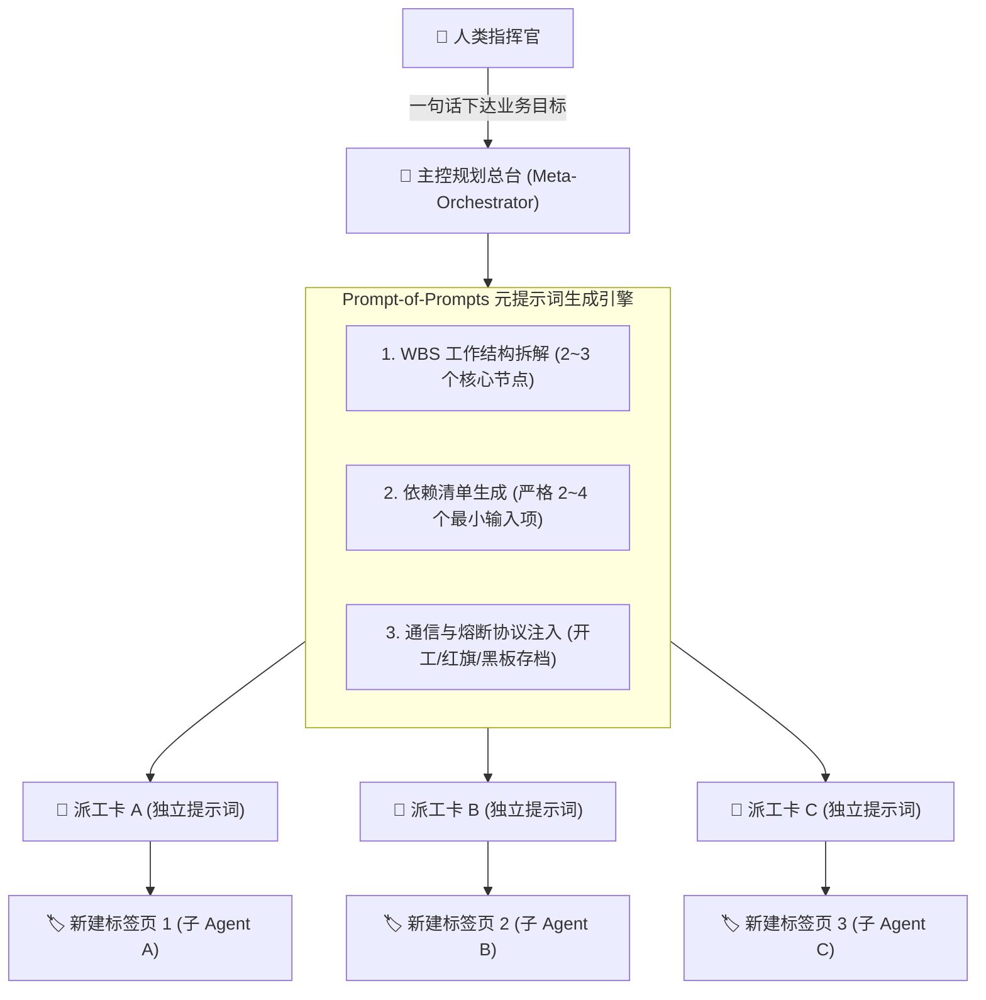
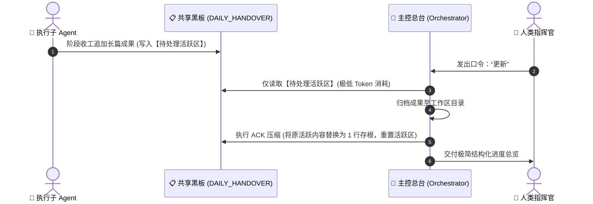

# MetaAgentFlow 核心架构与原理解析 (System Architecture)

> **核心命题**：如何在大模型无需高频 API 计费、普通用户无需 Python 编码的前提下，构建高并发、高鲁棒性、永不降智的多智能体协作系统？

---

## 1. 为什么单会话“越聊越笨”？（认知负荷与注意力衰减）

当前主流大语言模型基于 Transformer 自注意力机制（Self-Attention）。在传统的单对话框长程交互中：
- 随着交互轮数超过 15~20 轮，历史上下文中的试错代码、废弃草稿、修改意见与客套寒暄呈线性膨胀。
- 模型在预测下一个 Token 时，计算资源必须分摊至前序海量无关字符中，导致**上下文注意力稀释（Context Dilution）**。
- **直接恶果**：响应速度暴跌、对核心系统约束的选择性遗忘、事实幻觉频发（“胡言乱语”）。

---

## 2. 哲学突破：Chat-Native 与物理级会话隔离

**MetaAgentFlow** 放弃了在单会话内做复杂上下文窗口滑动的妥协方案，转而采用操作系统的基础哲学——**物理级进程隔离**：

1. **会话即容器（Session as Container）**：
   - 充分利用现代浏览器多标签页（Tabs）、多窗口（Windows）或终端多会话天然的内存沙盒特性。
   - 每一个具体子任务（如：资料检索、数据清洗、Prompt 编写、代码审查）都在全新的空白对话框中运行，**上下文从第 1 轮开始，永远处于注意力算力峰值**。
2. **任务即用即抛（Disposable Execution）**：
   - 子 Agent 完成单点目标并向共享黑板写入结构化交付后，该会话生命周期即告终结。上游的大量试错与调试噪音被物理截留在该标签页内，绝不污染全局。

---

## 3. 元提示词生成引擎 (Prompt-of-Prompts Engine)

在传统架构中，编写多智能体提示词需要工程师手动配置繁琐的 YAML 或 Python 类。
在 MetaAgentFlow 中，**主控总台 (Meta-Orchestrator)** 扮演“智能体制造局”：

- **高密度输出**：主控总台不负责撰写几千字具体细节正文，而是为每个子节点生成量身定制的【派工卡】。
- **即拷即用**：人类指挥官只需点击新建标签页，粘贴该派工卡，一个专属于该任务的高级智能体瞬间激活。

---

## 4. 双分区黑板总线与 Queue & ACK 机制

受经典分布式人工智能**黑板系统（Blackboard Architecture）**启发，所有 Agent 之间**互不建立直接点对点通信（杜绝网状通信引发的 $O(N^2)$ 上下文爆炸）**，统一通过单页文档（如 `DAILY_HANDOVER.md`）解耦。

为了防止多次微同步导致黑板越变越长，MetaAgentFlow 设计了**双物理分区收口算法**：

### 分区定义：
1. **⚡ 【待处理活跃区】(Active Zone / Queue)**：
   - 处于只追加（Append-Only）队列状态。
   - 任何子 Agent 收工时，将【全景存档卡】无脑追加至末尾。
2. **📥 【已结算入库区】(Compacted Zone / ACK)**：
   - 当主控执行同步时，消费活跃区内容，并在已结算区打上一行存根标记：
     `[x] [1105-架构-01] 核心战果：完成多智能体架构图解。详情见 docs/ARCHITECTURE.md`
   - **防重读保证**：日内无论进行第 2 次还是第 10 次更新，主控均跳过已结算区，彻底避免重复读取历史汇报。

---

## 5. 以睡为界的自然作息时间法则

传统定时调度往往以“午夜 00:00”强行切断日期，给高强度脑力工作者带来编号混乱。
MetaAgentFlow 引入人机共生作息原则：
- **以睡为界（Sleep-Cycle Day Boundary）**：无论熬夜至凌晨 02:00 还是 04:00，只要人类指挥官未上床睡觉，系统统一定义为同一作战日，保持当日编号连续（如 `1105-*`）。
- **睡前大更**：人类发出“我要休息了”，触发全天最终大盘点，清空活跃区，并在次日起床后自增轮换至下一日期（如 `1106-*`）。
